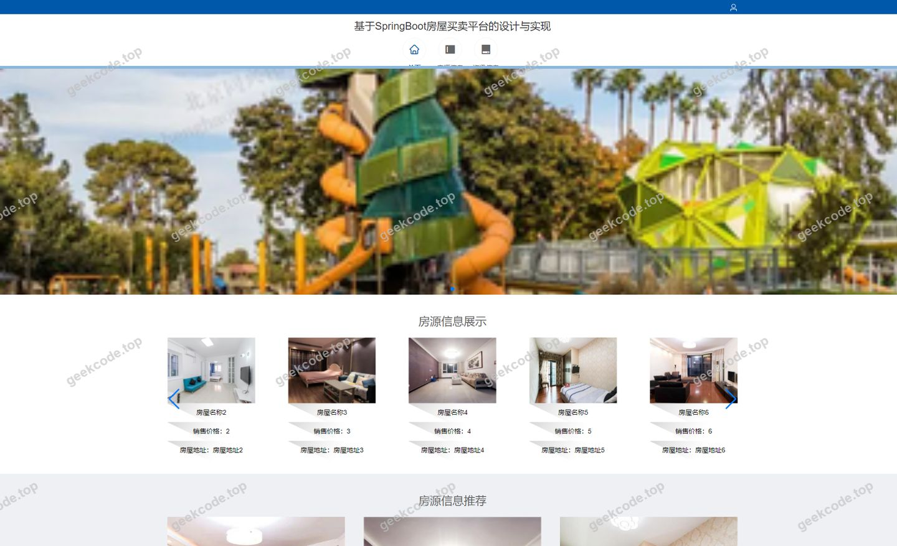
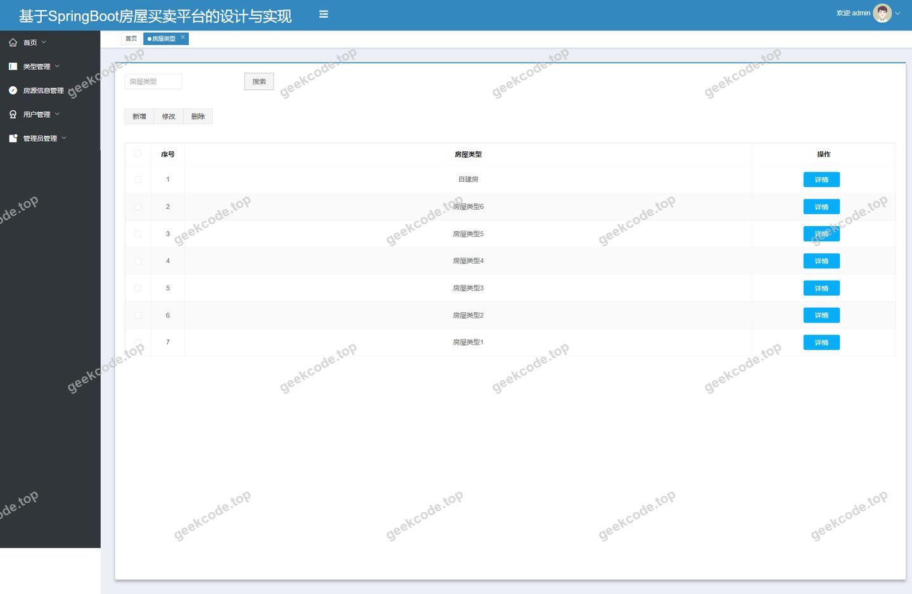
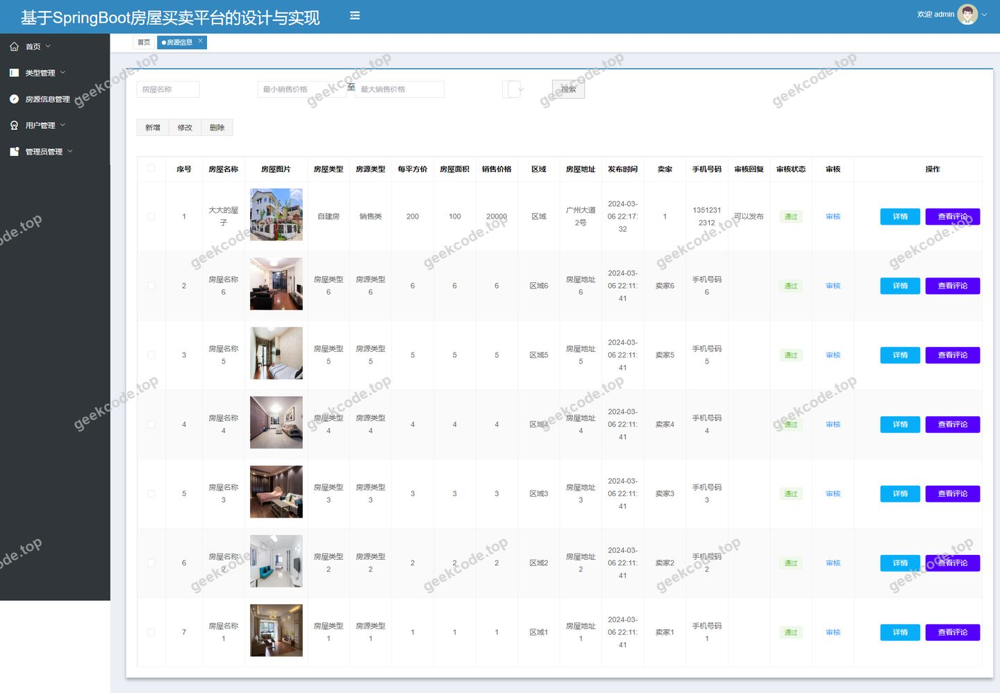
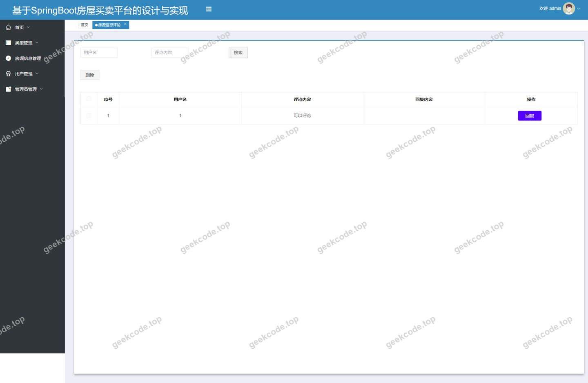
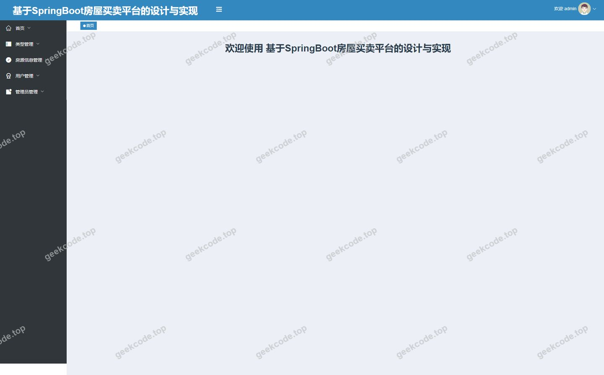
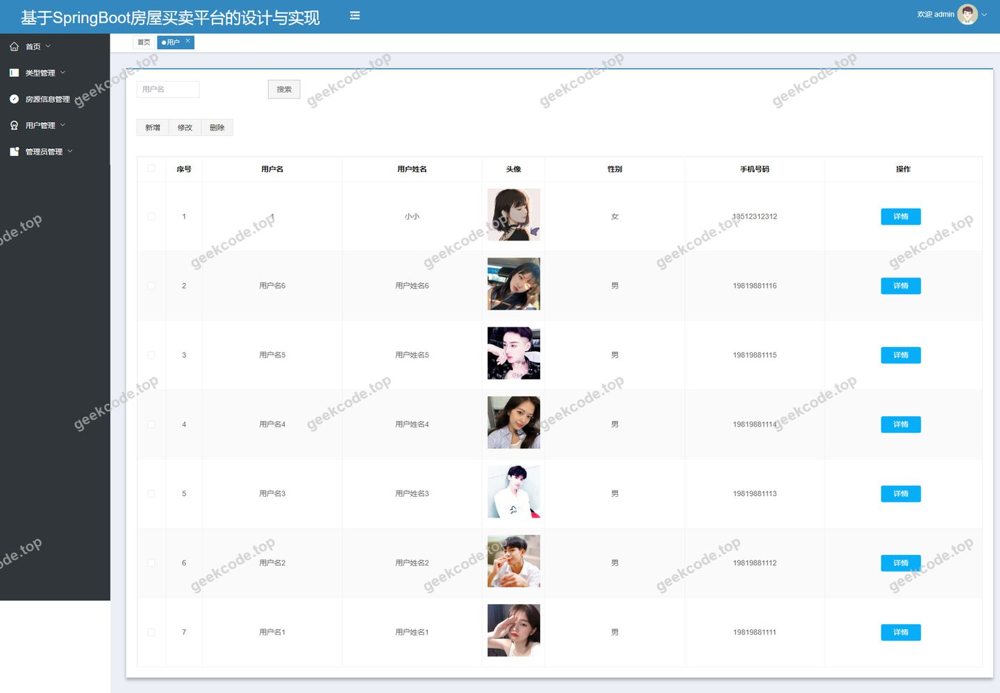
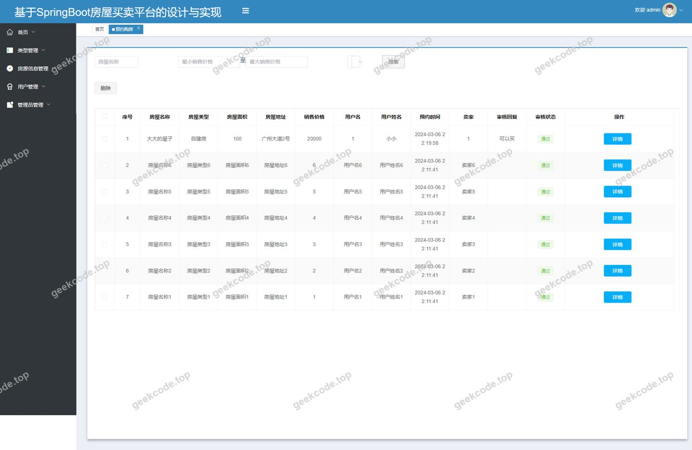
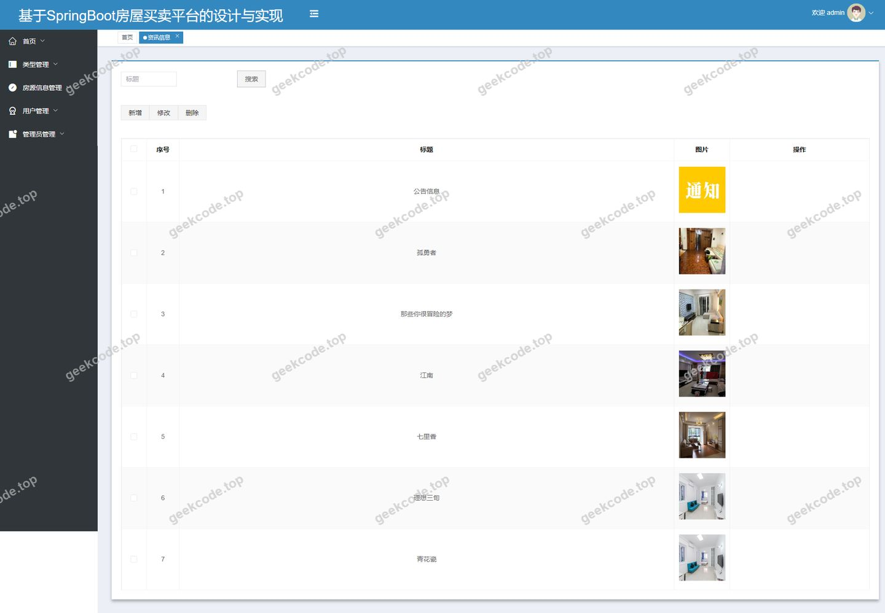

# [springboot]基于SpringBoot房屋买卖平台的设计与实现

> 🎓 **计算机毕业设计 · [springboot]基于SpringBoot房屋买卖平台的设计与实现**
>
> 本仓库只放**项目介绍 + 运行截图**（截图是站点带水印的原图，存在仓库 `images/` 里）。
>
> 👉 **完整可运行源码 / 数据库脚本 / 部署文档：[点我获取](https://geekcode.top/archives/springboot-%E5%9F%BA%E4%BA%8ESpringBoot%E6%88%BF%E5%B1%8B%E4%B9%B0%E5%8D%96%E5%B9%B3%E5%8F%B0%E7%9A%84%E8%AE%BE%E8%AE%A1%E4%B8%8E%E5%AE%9E%E7%8E%B0?utm_source=github)**
>
> 💬 咨询微信：**ir9372**　|　🌐 更多项目：[极客代码 geekcode.top](https://geekcode.top/?utm_source=github)
>
> 📌 项目详情页：<https://geekcode.top/archives/springboot-%E5%9F%BA%E4%BA%8ESpringBoot%E6%88%BF%E5%B1%8B%E4%B9%B0%E5%8D%96%E5%B9%B3%E5%8F%B0%E7%9A%84%E8%AE%BE%E8%AE%A1%E4%B8%8E%E5%AE%9E%E7%8E%B0?utm_source=github>

<table><td width="230" align="center"> <b>扫码加微信 ir9372</b></td><td valign="middle">📦 源码 = 项目介绍 + 全部运行截图 + 数据库 + 部署文档 👉 点上方任意截图，直接跳到 <b>极客代码 geekcode.top</b> 详情页</td></table>

---

<h1>[springboot]基于SpringBoot房屋买卖平台的设计与实现</h1>
<h2>项目概述</h2>

本项目旨在构建一个基于 Spring Boot 的房屋买卖平台，解决传统房产交易中信息分散、沟通效率低的问题。系统采用前后端分离架构，前端基于 Vue 技术栈实现交互界面，后端使用 Spring Boot 结合 MyBatis-Plus 进行业务逻辑处理与数据持久化，并通过 Shiro 框架保障系统安全。核心功能涵盖房源信息管理、房屋类型分类、在线预约购房、交易记录管理及资讯发布等模块。适用人群包括普通购房者（用户）和平台管理员。该系统为房产中介或线上交易平台提供了标准化的数字化管理解决方案，实现了从房源展示、用户注册登录到预约看房、购买确认的全流程闭环管理。

<h2>技术架构</h2>
<h3>1. 总体架构</h3>

系统采用典型的 B/S 架构，分为前端展示层、后端服务层和数据存储层。

<ul>
<li><strong>前端展示层</strong>：基于 Vue.js 框架构建，包含前台用户端页面和后台管理端页面。通过 Axios 等 HTTP 客户端与后端接口通信，实现数据的动态渲染和用户交互。</li>
<li><strong>后端服务层</strong>：基于 Spring Boot 框架开发，利用其自动配置特性快速搭建 Web 应用。集成 Apache Shiro 进行身份认证和权限控制，确保系统安全性。使用 MyBatis-Plus 作为 ORM 框架，简化数据库操作代码。</li>
<li><strong>数据存储层</strong>：采用 MySQL 关系型数据库存储业务数据，包括用户信息、房源详情、订单记录等。</li>
</ul>
<h3>2. 核心技术选型理由</h3>
<ul>
<li><strong>Spring Boot</strong>：提供“约定优于配置”的开发体验，内置 Tomcat 容器，简化了部署流程，适合快速迭代开发。</li>
<li><strong>MyBatis-Plus</strong>：在 MyBatis 基础上增强，提供了通用的 CRUD 操作和多表关联查询支持，显著减少样板代码，提升开发效率。</li>
<li><strong>Apache Shiro</strong>：轻量级且强大的 Java 安全框架，能够灵活处理认证、授权、会话管理和加密需求，适用于本项目的多角色权限隔离场景。</li>
<li><strong>Vue.js</strong>：渐进式 JavaScript 框架，组件化开发模式使得前后台界面复用率高，维护成本低，用户体验流畅。</li>
</ul>
<h3>3. 数据库设计要点</h3>

数据库设计遵循第三范式，主要实体包括用户、房源、房屋类型、预约记录、购买记录、评论及资讯等。各表之间通过外键建立关联关系，例如房源信息关联房屋类型 ID，预约记录关联用户 ID 和房源 ID，确保数据的一致性和完整性。

<h2>功能模块</h2>

根据路由配置及截图所示，系统功能划分为前台用户端和后台管理端两大板块。

<h3>1. 前台用户端功能</h3>

前台面向注册用户，提供浏览、搜索、互动及个人中心管理服务。

<ul>
<li><strong>首页与资讯浏览</strong> (<code>/index/newsList</code>)：展示平台最新房产资讯、政策动态或促销活动，帮助用户获取市场信息。</li>
<li><strong>用户注册与登录</strong> (<code>/yonghuRegister</code>, <code>/index/yonghuDetail</code>)：新用户需填写基本信息完成注册；已注册用户可登录并查看或修改个人资料。</li>
<li><strong>房源浏览与筛选</strong> (<code>/index/fangyuanxinxiList</code>, <code>/index/fangwuleixingList</code>)：用户可按房屋类型分类浏览房源列表，点击查看详情页 (<code>/index/fangyuanxinxiDetail</code>)，获取价格、面积、位置等详细信息。</li>
<li><strong>预约购房</strong> (<code>/index/yuyuegoufangAdd</code>, <code>/index/yuyuegoufangList</code>)：用户对意向房源发起预约看房申请，并可查看历史预约状态。</li>
<li><strong>购买交易</strong> (<code>/index/goumaifangziAdd</code>, <code>/index/goumaifangziList</code>)：确认购买意向后生成购买订单，用户可查看个人购买记录。</li>
<li><strong>收藏管理</strong> (<code>/index/storeupList</code>)：用户可将感兴趣的房源加入收藏夹，便于后续对比查看。</li>
<li><strong>个人中心</strong> (<code>/index/yonghuCenter</code>)：聚合显示用户的个人信息、预约记录、购买记录及收藏列表。</li>
</ul>
<h3>2. 后台管理端功能</h3>

后台面向管理员，提供全量数据的管理与维护功能。

<ul>
<li><strong>系统首页</strong>：展示关键业务数据统计概览（具体统计项依据实际实现而定）。</li>
<li><strong>用户管理</strong> (<code>/yonghu</code>)：管理员可查看所有注册用户信息，执行增删改查操作，管理用户状态。</li>
<li><strong>房源信息管理</strong> (<code>/fangyuanxinxi</code>)：核心业务模块，管理员负责录入新房源、编辑现有房源详情、删除无效房源以及审核房源信息的准确性。</li>
<li><strong>房屋类型管理</strong> (<code>/fangwuleixing</code>)：维护房源的分类体系（如住宅、公寓、别墅等），支持类型的添加、修改和删除，为前台筛选提供基础数据。</li>
<li><strong>预约购房管理</strong> (<code>/yuyuegoufang</code>)：查看用户提交的预约申请，处理预约状态（如确认、取消、完成），协调看房时间。</li>
<li><strong>购买记录管理</strong> (<code>/goumaifangzi</code>)：监控所有成交订单，核实交易信息，支持对异常订单进行处理。</li>
<li><strong>评论管理</strong> (<code>/discussfangyuanxinxi</code>)：审核用户对房源的评论内容，过滤违规信息，维护社区讨论氛围。</li>
<li><strong>资讯管理</strong> (<code>/news</code>)：发布、编辑或删除前台展示的新闻资讯内容。</li>
<li><strong>收藏管理</strong> (<code>/storeup</code>)：查看用户的收藏行为数据，辅助分析热门房源。</li>
<li><strong>系统配置</strong> (<code>/config</code>)：管理系统的基础参数配置。</li>
</ul>
<h2>用户角色与权限</h2>

系统主要包含两类角色：<strong>普通用户</strong>和<strong>管理员</strong>。不同角色拥有不同的访问路径和操作权限。

<table>
<thead>
<tr>
<th align="left">角色</th>
<th align="left">访问入口</th>
<th align="left">可操作功能模块</th>
<th align="left">权限描述</th>
</tr>
</thead>
<tbody><tr>
<td align="left"><strong>普通用户</strong></td>
<td align="left">前台网站</td>
<td align="left">1. 注册/登录2. 浏览资讯3. 浏览房源及类型4. 查看房源详情5. 发起预约购房6. 提交购买申请7. 收藏房源8. 评论房源9. 个人中心管理</td>
<td align="left">仅能操作与自己相关的数据（如自己的预约、订单、收藏）。无法进入后台管理界面，无法直接修改房源基础信息或管理其他用户。</td>
</tr>
<tr>
<td align="left"><strong>管理员</strong></td>
<td align="left">后台管理系统</td>
<td align="left">1. 用户管理2. 房源信息管理3. 房屋类型管理4. 预约购房管理5. 购买记录管理6. 评论管理7. 资讯管理8. 收藏管理9. 系统配置</td>
<td align="left">拥有最高权限，可对系统中所有数据进行增删改查操作。可以管理用户账号、审核和处理所有业务单据（预约、购买）、维护基础字典数据（类型、资讯）以及查看全局统计数据。</td>
</tr>
</tbody></table>
<h2>项目特色与创新点</h2>
<ol>
<li><strong>全流程交易闭环</strong>：项目不仅仅提供房源展示，还完整覆盖了“浏览-收藏-评论-预约-购买”的用户行为链路，实现了从信息获取到交易意向达成的数字化闭环。</li>
<li><strong>多维度的内容管理</strong>：除了核心的房源交易数据，系统还集成了“资讯新闻”和“用户评论”模块。资讯模块增强了平台的信息服务属性，评论模块则构建了用户间的互动社区，提升了平台的用户粘性和活跃度。</li>
<li><strong>基于 Shiro 的安全管控</strong>：引入 Apache Shiro 框架替代简单的 Session 验证，提供了更细粒度的权限控制和更安全的会话管理机制，有效防止越权访问和数据泄露风险。</li>
<li><strong>前后端分离架构</strong>：采用 Vue + Spring Boot 的主流技术组合，前端专注于视图渲染与交互逻辑，后端专注于业务处理与数据持久化。这种架构降低了系统耦合度，便于后续的功能扩展和维护，同时也提升了页面的加载速度和用户体验。</li>
</ol>
<h2>部署环境</h2>

为确保系统正常运行，需准备以下软件环境：

<ol>
<li><strong>JDK</strong>：Java Development Kit，版本建议 JDK 1.8 或以上，用于编译和运行 Spring Boot 后端程序。</li>
<li><strong>Maven</strong>：项目构建工具，用于依赖管理和打包部署。</li>
<li><strong>MySQL</strong>：关系型数据库服务器，版本建议 MySQL 5.7 或 MySQL 8.0，用于存储业务数据。需创建对应的数据库实例并导入初始化 SQL 脚本。</li>
<li><strong>Node.js &amp; npm/yarn</strong>：前端开发环境，用于安装 Vue 依赖包、编译前端代码及启动前端开发服务器。</li>
<li><strong>浏览器</strong>：主流现代浏览器（如 Chrome, Firefox, Edge），用于访问前台和后台管理界面。</li>
<li><strong>IDE</strong>：推荐 IntelliJ IDEA 或 Eclipse，用于后端代码开发与调试；VS Code 用于前端代码开发。</li>
</ol>
<h2>五、技术特性</h2>
<ul>
<li>前后端集成部署，前端资源打包至后端 static 目录</li>
<li>使用 MyBatis-Plus 简化数据访问层开发</li>
<li>集成 Shiro 权限框架实现角色权限控制</li>
</ul>
<h2>六、功能模块截图</h2>
<h3>前台用户端</h3>
<h4>前台-首页</h4>

<h4>前台-登录</h4>

<h4>前台-用户注册</h4>

<h3>后台管理端</h3>
<h4>后台-登录页</h4>

<h4>后台-房屋类型</h4>

<h4>后台-房源信息</h4>

<h4>后台-房源信息评论</h4>

<h4>页面-首页</h4>

<h4>后台-用户</h4>

<h4>后台-预约购房</h4>

<h4>后台-资讯信息</h4>

---

## 获取完整源码

| 项目 | 说明 |
| --- | --- |
| 项目名 | [springboot]基于SpringBoot房屋买卖平台的设计与实现 |
| 运行截图 | 本文 11 张（站点带水印原图，仓库 `images/` 目录） |
| 完整源码 | [https://geekcode.top/archives/springboot-%E5%9F%BA%E4%BA%8ESpringBoot%E6%88%BF%E5%B1%8B%E4%B9%B0%E5%8D%96%E5%B9%B3%E5%8F%B0%E7%9A%84%E8%AE%BE%E8%AE%A1%E4%B8%8E%E5%AE%9E%E7%8E%B0?utm_source=github](https://geekcode.top/archives/springboot-%E5%9F%BA%E4%BA%8ESpringBoot%E6%88%BF%E5%B1%8B%E4%B9%B0%E5%8D%96%E5%B9%B3%E5%8F%B0%E7%9A%84%E8%AE%BE%E8%AE%A1%E4%B8%8E%E5%AE%9E%E7%8E%B0?utm_source=github) |
| 咨询微信 | **ir9372**（备注：jingpin-yuanma） |
| 更多项目 | [极客代码 geekcode.top](https://geekcode.top/?utm_source=github) |

> 需要源码、部署、改配置、跑不起来等问题，加微信 ir9372 沟通，说明项目名即可。
